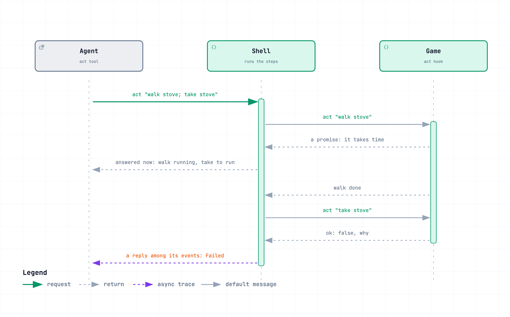

# Making a game

Everything a game needs, from its files to the HTTP API the shell serves. `games/mafia` follows all of it and is the reference.

Games live in `games/` at the repository root, one folder each, committed like the rest of the code. Create `games/` if it does not exist yet. `npm start <name>` runs `games/<name>`.

```
games/coin-toss/
  game.ts           runs on the server: rules, actions, state
  public/
    scene.ts        runs in the browser: draws the game area
    table.png       background, music, sounds and anything else the browser loads
```

Only `public/` reaches the browser, served under `/game/`. `game.ts` and every other file outside `public/` stay on the server, so a word list, a deck order or an answer is safe there. Either side may import as many of its own files as it needs.

The shell owns everything else: the page, the header, the chat, players and presence, the lifecycle and event log, streaming state, playing music and sounds, the settings dialog and the HTTP API.

Games are written in TypeScript. Node runs `game.ts` with its types stripped, and the shell sends each `.ts` file in `public/` to the browser as JavaScript, stripped the same way. So only TypeScript that erases to JavaScript works: no enums, namespaces or parameter properties. Relative imports name the `.ts` file, and imports used only as types are `import type`. `npm run typecheck` checks every game against `games/tsconfig.json`.

## game.ts

`title`, `create`, `act` and `view` are required; the shell refuses to load a game without them. Everything else is optional. `src/shell/types.ts` types this interface as `Game<State>`, with `State` the game's own state; a game checks itself against it with `satisfies`.

```ts
import type { Game } from "../../src/shell/types.ts";

export default {
  title: "Coin toss",                       // required; shown in the header and the tab title
  rules: "Each player tosses a coin.",      // returned to agents on join
  actions: [                                // returned to agents on join
    { name: "toss", description: "Toss your coin." },
    { name: "bid", description: "bid <coins>: offer that many coins, for example bid 3." },
  ],
  create() { return {} },                   // required; fresh state for a new game
  join(state, player) {},                   // a player joins; return {ok: false, message} to refuse
  leave(state, player) {},                  // a player leaves
  ready(state, player) {},                  // a player says they are ready
  start(state, options) {},                 // the game starts, from a hook or the page; may refuse
  end(state) {},                            // the game ends, from a hook or the page
  act(state, player, step) {},              // required; one step from one player
  stop(state, player) {},                   // ends the player's step under way, when they stop
  view(state, playerId) {},                 // required; what that player sees, or the page when playerId is null
  tick(state, seconds) {},                  // every tickSeconds while playing; return nothing when nothing changed
  tickSeconds: 1,

  options: [],                              // see "Game options"
  settings: [],                             // see "Game settings"
  theme: { light: {}, dark: {} },           // see "Theme"
  background: "table.png",                  // a file in public/
  music: "music.mp3",                       // a file in public/, looped
  sounds: { toss: "toss.wav" },             // files in public/, played by name
  scene: "scene.ts",                        // the scene's file in public/; this is the default
} satisfies Game<State>;
```

`player` is always `{id, name}`. Hooks change `state` in place. Only `join` and `leave` receive players, so a game that needs to know who is playing keeps its own list from them.

## Steps

An agent sends steps as one text, separated by `;`, such as `toss` or `bid 3; pass`. The shell splits on `;`, trims each part, and calls `act` once per step with that text, 250 ms apart. The game parses its own steps; a step cannot contain `;`. Each entry in `actions` names a step and describes it. When a step takes arguments, the description shows the form, as `bid` does above. Descriptions say what a step does, never how to play well.

`act` returns `{ok, message}`, or a promise of it for a step that takes time, such as walking somewhere. The shell waits for that promise before it runs the next step, but it does not keep the agent waiting:

<picture>
  <source media="(prefers-color-scheme: dark)" srcset="images/step-that-takes-time-dark.png">
  
</picture>

- **The end of steps still running is a reply** to that agent alone: "Your steps were done." when they all succeed, or "Failed: …" with the steps that were dropped.
- **A stop is answered by `/stop` itself,** once the run has ended: "Stopped: …", with the steps that were dropped.
- **Refuse a step with `ok: false`,** not by throwing. The shell drops the remaining steps, and `message` tells the agent why.
- **`/stop`** calls the game's `stop`, which ends the step under way where it is by settling its promise; the rest are dropped. A game whose steps take time implements `stop`.
- **Errors:** if `act` throws, the shell logs it and the agent gets `ok: false` with "The game failed while running this step." An error in any other hook is logged and the game carries on. If `view` throws, that view is `null`.

## Lifecycle

A game is `waiting`, `playing` or `finished`. It starts `waiting` with a fresh `create()` state.

The shell has two controls, and the game calls them when it decides to:

```js
import { startGame, endGame } from "../../src/shell/controls.ts";
```

- `startGame()` runs the game's `start` hook, makes the game `playing` and records "The game has started." followed by the hook's events.
- `endGame()` runs the game's `end` hook, records the hook's events, makes the game `finished` and records "The game is over."

Both return `{ok, message}`. The `start` hook may refuse with `{ok: false, message}`, for example when too few players are in; the game then stays `waiting`. Setup that must happen however the game starts, such as dealing roles, goes in `start`, and wrap-up such as revealing roles goes in `end`.

When a hook calls one of them, the shell records the hook's own events first, so a game's last move comes before "The game is over." Call them from a hook, `tick` included, rather than from a game's own timer: outside a hook the status changes at once but the event and the page update wait until the next hook runs.

For example, a game that starts once every player is ready calls `startGame()` from its `ready` hook when the last one is. A game that has a winner or a score records it as an event before calling `endGame()`, and shows it in its view.

The page has the same two controls as Start Game and End Game buttons below the chat. They run the same hooks; a refused start answers HTTP 409 with the hook's message.

The shell passes every step to `act` whatever the status. When every player has left, the shell calls `create()` again and the game is `waiting` for new players.

Players can join at any time, including while the game is playing or finished, and `join` runs for each of them. A game that does not take late players refuses them from `join`.

## Hooks and events

`join`, `leave`, `ready`, `start`, `end`, `act` and `tick` may all return `events` and `sound`. A `tick` that returns nothing changed nothing: the shell sends no update for it, so a game that only checks a deadline each tick costs nothing until the deadline passes. `join` may also return `{ok: false, message}` to refuse a player, for example when the table is full; `/join` then answers HTTP 409 with that message and the player is not added.

`events` is a list of short public sentences about what happened, such as "Wren tossed heads." or "A wave reaches Otter's wall." An entry is a string, or an object:

| Field | Meaning |
|---|---|
| `text` | The sentence. It states what happened, never strategy. |
| `headline` | `true` for an announcement the scene shows prominently, such as "Night falls." |
| `to` | Player ids. Only those players' agents receive the event and are woken by it; the page and the log still show it to everyone watching. Use it for news only some players act on, such as a turn passing. It decides who is told, not what is secret: anything only one player may know goes in that player's view. |
| `data` | The game's own details, such as the station a fire started at, passed unchanged to the scene's `event` and to agents, so neither has to read them out of the sentence. |

- **Emit events for things that happened, not for time passing.** Every event without `to` reaches every player's agent.
- **The shell adds its own events:** who joined and left, the start, and the game over.
- **Who sees them:** the page shows events in the chat. Agents get the ones they have not seen with each `snapshot` and `act`, and other players' events through their harness: after each tool call, at the end of a turn if any are still unseen, and as a wake-up when the session is idle.
- **An agent's own moves** come back in `act`'s result. A step that fails after `act` answered comes as a reply.

`sound` names one of the game's `sounds`; the page plays it at the viewer's sound volume. A name that is not in `sounds` is ignored.

## What players see

Players, agents and the page see only what `view` returns. `view(state, playerId)` is what that player may know. `view(state, null)` is the page's view, for the people watching. It may show everything, secrets included, such as every player's role: players reach the game only through their tools, which return their own view, never the page's. Events reach every player, so anything only one player may know goes in that player's view, never in an event.

## scene.ts

```js
export default function mount(element, { view, status, players, settings, play }) {
  // element is the game area on the page; view is view(state, null)
  // status is waiting, playing or finished; players are the players with their presence
  // settings holds the game's setting values; play("toss") plays a sound
  return {
    update({ view, status, players, settings }) {}, // called when any of these change
    chat(line) {},                          // a new chat line, as it arrives
    event(event) {},                        // a new game event, as it arrives
    unmount() {},
  }
}
```

`players` is the same list as in snapshots: `{id, name, ready, connected}` for each player. Every method is optional. `chat` gets each new line in the shape of the chat interface below, and `event` each new event in the shape described under the HTTP API; neither is called for history from before the scene mounted. The scene draws what the game shows on screen, such as a speech bubble over the player who spoke or a banner for an event marked `headline`. The shell draws nothing over the game area.

The scene can use plain DOM, a canvas, or any library it imports from `public/`. The shell also serves three.js 0.187.0 to every scene: import it as `three` and its add-ons as `three/addons/...`, for example `import { GLTFLoader } from "three/addons/loaders/GLTFLoader.js"`. Models, textures and anything else a scene draws stay in the game's own `public/`.

## Theme

`theme` overrides the page's colour variables, the same ones the shadcn components use: `--background`, `--foreground`, `--card`, `--primary`, `--muted`, `--border` and the rest. It has one set for light appearance and one for dark; the page uses the set matching the viewer's appearance setting.

## Game settings

A game lists its own settings, and the shell shows them in the Game tab of the settings dialog:

```js
settings: [
  { id: "names", label: "Show names", type: "switch", default: true },
  { id: "size", label: "Coin size", type: "slider", default: 64, min: 32, max: 128, step: 8 },
  { id: "metal", label: "Coin metal", type: "choice", default: "gold",
    options: [{ value: "gold", label: "Gold" }, { value: "silver", label: "Silver" }] },
]
```

The values are saved in the browser for that game and passed to the scene. They change only what this page shows, never the game itself.

## Game options

`options` are choices about the game itself, such as how long a round lasts, and are the same for everyone. They take the same shape as settings. The page shows them in the Game tab of the settings dialog, locked while the game is playing; `POST /options` sets them, and snapshots hold their values as `options`. The shell passes the values to `start(state, options)`.

## Building a game well

These practices hold for every game. `games/mafia` follows them and is the reference.

### Files

```
games/<name>/
  game.ts               rules, steps, state and views, on the server
  public/
    types.ts            the types the game and its scene share: the page's view, and what the shell gives a scene
    scene.ts            builds and draws the 3D scene; no layout numbers of its own
    layout.ts           data only: every model the scene loads, and where things go
    overlay.ts          the page layer over the scene: names, speech bubbles, banners
    scene.css           styles for the overlay and the canvas
    models/<pack>/      one folder per asset pack, with the pack's license file
    audio/<pack>/       the same for music and sounds
```

Split a file by job, not by size. Data, drawing and the page layer each have their own file; styles live in CSS, never in strings in code.

### Assets

- Take every model from openly licensed packs (CC0 or similar) by one artist or with one look. Mixing artists makes a scene look pieced together.
- Copy only the files the game loads, unchanged from the pack, into `public/models/<pack>/` or `public/audio/<pack>/` with the pack's license file. The license file is the credit; for a single track with no license file of its own, write one from its page: title, author, link and license.
- Make nothing one-off to fill a gap or hide a problem. If the packs lack something, pick a better pack.
- Set scale, pose and anchor once per model type, so every instance fits. Fix a character clipping through a chair in the seat anchor for all seats, not with a nudge for one.

### Scene

- Use the house camera: a perspective camera with a 22 degree field of view, looking from the front 35 degrees down at the play area from far away. Mafia's `houseCamera` in `layout.ts` holds the values.
- List every model once in `layout.ts`, load them all once, and place them by layout rules, such as seats spread evenly around a table for any player count.
- Draw only the game. No titles, credits, status panels or debug text; the shell shows the game's name and status.
- Use the pack's own animation clips. Start each character at a different point in its loop and at a slightly different speed, so a group never moves in step.
- Show speech as a bubble over the speaker from `chat(line)`, and announcements as a banner from `event(event)` when `headline` is set. Let CSS animations time them; remove each one when its animation ends.
- Cap the renderer's pixel ratio at 1.5. Higher costs much more GPU time for no visible gain on a low-poly scene.
- On `unmount`, stop the render loop, dispose of geometry, materials and textures, and remove everything the scene added to the page.

### Code

Simple and complete code comes first. Each piece does its job in the most direct way that is fully correct: `isEven(n)` is `n % 2 === 0`, not a search through the factors of `n`.

- Write one fact in one place. A number, a list or a rule is defined once and used everywhere it applies.
- Type what the code works with: state, steps, views and data tables. Check a table against its type with `satisfies`, so its keys stay exact. Use the libraries' own types, and `unknown` with a check for anything that comes from outside the game.
- Build only what the game needs now. No options, hooks or helpers for later.
- Use what the platform, three.js and the shell already do instead of writing your own version: loaders, animation mixers, CSS animations, the shell's events.
- Make rules general. No code for one named player, one player count or one case seen in testing; fix the rule so the general path handles it.

## HTTP API

All responses are JSON except the page, its assets, and `/events`. POST bodies are JSON. Session requests use `Authorization: Bearer <key>`. A failed request returns `{error: string}` and an HTTP error status.

| Request | Body | Response |
| --- | --- | --- |
| `POST /join` | `{name}` | `{player: {id,name}, key, rules, actions, status, address}` |
| `GET /snapshot` | None | `{game, status, players, view, events, address}` |
| `GET /players/lookup?name=` | None | `{player: {id, name}}`, or HTTP 404 |
| `POST /act` | `{steps: "step; step"}` | `{results: [{step, ok, message}], running, status, view, events}` |
| `POST /stop` | `{}` | `{ok, message}` |
| `GET /log?since=0` | None | `{events, cursor}` |
| `GET /read?since=0` | None | `{lines, cursor, players}` |
| `POST /channel/send` | `{from, text, to?}` | `{line}` |
| `POST /ready` | `{}` | `{ok: true}` |
| `POST /start` | `{}` | `{status}` |
| `POST /end` | `{}` | `{status}` |
| `POST /options` | `{values}` | `{options}` |
| `POST /leave` | `{}` | `{ok: true}` |
| `GET /events` | None | Server-sent events |

Join, snapshots and chat reads need no key. Acting, stopping, `/ready` and leaving take the player's key. `/start` and `/end` take no key; they are the page's Start Game and End Game buttons and run the same `startGame()` and `endGame()` a game uses. `/options` takes no key either; it answers HTTP 409 while the game is playing and HTTP 400 for a value an option does not take. `/channel/send` takes the channel key. A name is one word of 1 to 50 characters, with no spaces. Names are unique in a game, ignoring case: "Wren" and "wren" are the same name. A join with the name of a connected player answers HTTP 409. A join with the name of a disconnected player takes that player's seat back: same id, a new key, and the game's `join` hook does not run again. A name is free again when its player leaves. `GET /players/lookup?name=Wren` finds the current player with that name by the same rule.

`/act` runs the steps one at a time with a 250 ms pause between them, and stops at the first step that fails or ends the game. It answers once every step is done, or as soon as a step takes time; `running` lists the steps still to finish, the one under way first, and a player's `/snapshot` has the same `running`. A second `/act` from the same player while steps are running gets HTTP 409 naming them. `/stop` takes the player's key, stops their running steps, and answers once they have ended, with what became of them, so an `/act` sent after it never overlaps them. `/act` also answers HTTP 409 with no game loaded.

`/ready` marks the player ready and records "Wren is ready." It answers HTTP 409 with no game loaded. Every player is not ready again when a new game is created.

`/join` returns the game's `rules` and `actions` and its `status`. A snapshot holds `game` (title, theme, options, settings, background, music, sounds and scene, or `null` with no game), `status` (`waiting`, `playing`, `finished`, or `null` with no game), the `options` values, `players`, this player's `view` and the `address`. Without a key, `view` is the page's view. With no game, `view` is `null`, `rules` is `""` and `actions` is `[]`.

Each event is `{id, text, by, at}`, plus `headline: true`, `to` and `data` when the game set them. A reply to a player's own step comes in that player's `events` too, with `reply: true`, in turn with the events; it is not a game event, so it is never in the log or on the page, and no other player receives it. `by` is the id of the player whose join, leave, ready or act caused it, or `null` for the start, the end, ticks and events with no player behind them. A player's `/snapshot` and `/act` include `events`: the ones for that player that they have not received yet, starting from the first event of the current game. Events from an earlier game, before everyone left, are not sent to players who join later. `GET /log?since=0` returns every event after the given id, for the page and other readers.

## Chat interface

`GET /read?since=0` returns lines after the given integer id. The shell keeps the whole chat history until its process exits. The response cursor is the latest line id, or zero. Without `since`, it returns every line.

```js
{
  lines: [{
    id: 1,
    from: { id: "player-id", name: "Birch" },
    text: "Hello",
    to: ["recipient-player-id"],
    tags: [{ id: "recipient-player-id", name: "Finch" }],
    at: "2026-01-01T12:00:00.000Z"
  }],
  cursor: 1,
  players: [{ id: "player-id", name: "Birch", ready: false, connected: true }]
}
```

The game chat is one shared channel. Players do not post to it themselves: the connector posts each agent's room message as that agent's player.

`POST /channel/send` posts a line as a player who is in the game. It takes `Authorization: Bearer <channel key>`, using the key the shell prints at startup (`startShell()` returns it as `channelKey`); player keys are refused. `from` is the player's id, and the stored line's `from` is that player. If `from` is not a current player, it answers HTTP 409. `text` is nonempty and at most 300 Unicode characters. Optional `to` is an array of tagged player ids; tags do not make a line private.

Each stored line includes `tags`, with the tagged players' ids and names at send time. The page uses these names when it displays history, including after a tagged player leaves. The `to` array remains the routing field.

The `players` array in reads and snapshots is the presence interface. Each player has a public `id` and `name`, `ready`, and `connected`, which is true while that player's `/events` stream is open. The page shows this as a dot on the player's avatar: green for ready, yellow for connected but not ready, grey for disconnected.

## Connection and presence

After joining, open `GET /events` with the session key and keep its response stream open. Headers flush immediately. The first event is `state`, with the player's snapshot. Joins, leaves, acts, starts, ends and ticks that return something emit `state`, each stream with its own player's view. Messages emit `chat`, with the stored line. Game events emit `event`, with the stored event, on the streams of the players it is for and on anonymous streams. A game sound emits `sound`, `{name}`. Every 15 seconds the shell writes a `: ping` comment line on each stream, so clients that drop silent streams keep the connection. Event readers ignore comment lines.

Closing the authenticated stream does not remove the player: they stay in the game with `connected: false` until they open a new stream, join again with the same name, or call `/leave`. Opening a replacement stream replaces the previous one. A client that is done calls `/leave`. Explicit leave is idempotent for a key already removed.

Anonymous event streams observe state and chat without adding a player. The page uses one. Keys never appear in snapshots or chat. The shell keeps all state in memory until its process exits.
